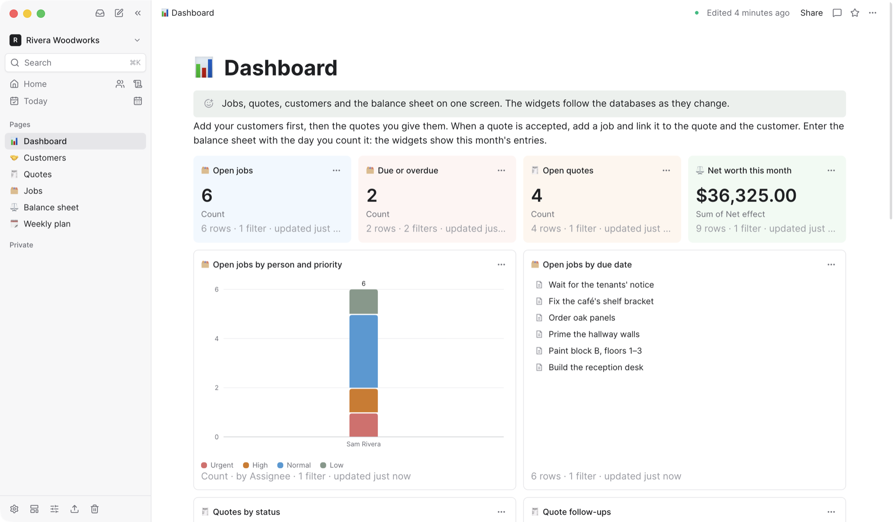
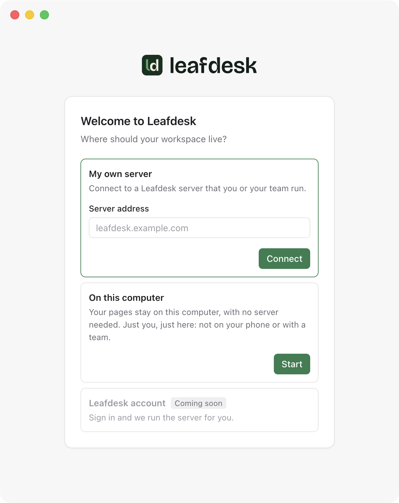

# Install and offline use

[← README](../README.md) · [All documentation](README.md)

**Installing.** Leafdesk is a web app with a manifest, icons and a service worker, so browsers
offer to install it: the install icon in Chrome's or Edge's address bar, "Install app" in the
workspace menu (shown only while the browser offers it; nothing pops up on its own), or "Add to
Home Screen" in Safari's share menu on iPhone and iPad. Installed, it opens in its own window and
starts at your last workspace. Installing needs HTTPS (or `localhost`).

**Offline.** Every page you open is also kept in the browser (its Yjs document, in IndexedDB).
Without a connection — no network, or the server is down — the page stays editable; the header
says "Offline", and "Offline · edits kept here" once you have changed something. When the
connection is back the edits are sent ("Syncing…", then "Synced") and merge with what others wrote
meanwhile. Pages edited offline and closed before the connection returned are sent in the
background the next time the app is open. In an installed app or a tab opened later, the service
worker serves the pages you opened before (the last 50) from its copy; others show a short
"You're offline" page listing what is available. The sidebar and the last 30 databases and rows
you opened stay readable offline; they are read-only until the connection is back, as are
sharing, comments, favorites, search, the inbox, new pages and the other actions that need the
server (their buttons say so).

**Downloaded pages.** *Available offline* in a page's ⋯ menu, or in the menu beside it in the
sidebar, downloads it to this device now: its content, a database's rows or a row's values, and
the files and images it shows (up to 10 MB each, 50 MB per page); *Include sub-pages* (*Include
rows*) brings up to 50 pages under it along. Favorites are downloaded too unless turned off.
Downloaded pages are never pushed out by newer ones, are fetched again every 15 minutes while the
app is online, and carry a quiet mark in the sidebar. Settings → Offline lists what this device
keeps (size, last update, edits not yet sent) and removes one page or all.

**After an update.** A tab opened before the server was updated stops syncing its pages and asks
to be reloaded ("Leafdesk has been updated"); edits made in it are kept in the browser and sent
after the reload. An older version of the editor would drop blocks it doesn't know yet, such as
ones a newer release added, from the pages it shows, and the change would reach everyone. So the
server turns down the collaboration connection of a tab from another build, and a tab doesn't
load a page's offline copy before it knows it runs the server's build (offline: the build another
tab of this browser last met). Each `next build` gets its own id; development has none.

**Privacy.** Offline copies are kept per user and removed when you sign out (after a warning if
some edits haven't reached the server yet), when someone else signs in on the same browser, and,
for a page, as soon as the server says it is gone or no longer shared with you. The collaboration
token is never stored. A browser profile shared by several people without signing out still
shares its offline copies, as it shares its cookies; sign out on shared computers.

The service worker (`public/sw.js`) runs in production builds only; `pnpm dev` removes one left
behind so hot reloading keeps working. It never caches API responses, uploads, server actions or
the collaboration socket. Images and files are kept offline only for downloaded pages.

### Desktop app

The desktop app for macOS, Windows and Linux works two ways. Connected to your Leafdesk server, it
is a window on it: it opens the server's own pages, so it always runs the server's build (see
*After an update*) and has nothing of its own to keep in step with it. *On this computer*, it runs
Leafdesk itself, with no server to set up, for one person.

<picture>
  <source media="(prefers-color-scheme: dark)" srcset="../.github/screenshots/desktop-dark.png">
  
</picture>

Download it from the [latest release](https://github.com/esmworks/leafdesk/releases/latest):

| System | File |
| --- | --- |
| macOS, Apple silicon | `Leafdesk-<version>-arm64.dmg` |
| macOS, Intel | `Leafdesk-<version>-x64.dmg` |
| Windows (64-bit) | `Leafdesk-Setup-<version>.exe` |
| Linux, x64 or arm64 | the `.AppImage` for your processor (make it executable, then run it) |

The macOS app is signed and notarized. The Windows installer isn't signed yet, so SmartScreen
warns the first time: choose *More info*, then *Run anyway*.

<picture>
  <source media="(prefers-color-scheme: dark)" srcset="../.github/screenshots/desktop-start-dark.png">
  
</picture>

**Connecting.** On first start the app asks where your workspace is. *My own server* takes the
server's address (`leafdesk.example.com`, or with `https://`, a port or `http://` for a server on
your network); the app tries HTTPS first and checks that the address answers like a Leafdesk server
(`/api/health` and the web app manifest) before it opens the sign-in page. When only plain HTTP
answers (and you didn't type `http://`), or the server sends the app on to another host or from
HTTPS down to HTTP, the app says so and connects only after *Connect anyway*. *Leafdesk account* is
shown as coming later. *Change Server…* in the app menu (File on Windows and Linux) goes back to
this screen; signing in again isn't needed for a server you used before.

**On this computer.** *Start* runs Leafdesk inside the app, with no server to set up: a PostgreSQL
database of its own and the Leafdesk server, reachable only from this computer (127.0.0.1). The
first start makes the computer's one account and its workspace and signs it in, so there is no
sign-in page and nobody else can sign up. The app signs in only once the server it started says
it holds the port, and that server answers only to `127.0.0.1` and `localhost`. The pages, uploaded files and the database live in the
app's profile folder, under `Local` (`~/Library/Application Support/Leafdesk` on macOS,
`%APPDATA%\Leafdesk` on Windows, `~/.config/Leafdesk` on Linux); quitting the app stops both
cleanly. Email, AI and other features that need settings stay off. The app is larger for it
(about 640 MB on macOS).

Since the workspace lives on one computer, the app backs it up: each workspace into one file in
`Documents/Leafdesk Backups`, when the last backup is a day old (a minute after Leafdesk starts,
then every hour while it runs), keeping the newest seven of each. *File → Choose Backup Folder…*
moves them, to a folder iCloud Drive, Dropbox or a network drive syncs for a copy off the computer;
*Back Up Now* and *Show Backups* are there too. A backup restores on any Leafdesk (*Restore from
backup…* when creating a workspace), on this computer or on a server. A scheduled backup that
fails is reported once as a notification.

**Self-signed certificates.** When the server's certificate isn't trusted by the system, the app
shows its SHA-256 fingerprint; compare it with the server's
(`openssl x509 -noout -fingerprint -sha256 -in cert.pem`) and choose *Trust this certificate*. The
app then trusts that one certificate for that host only, and asks again when it changes. When a
server that had a certificate the computer trusts (or another one you trusted) shows an untrusted
one, the screen warns that someone may be intercepting the connection. *Forget Trusted
Certificates* in the app menu (File on Windows and Linux) drops every certificate trusted this way,
restarting the app when the connected server's was one of them. A certificate from a certificate
authority the computer trusts (an internal one included) needs nothing.

**Tabs.** Each window holds tabs, in a strip at the top that follows Leafdesk's light or dark
look. On macOS it sits beside the sidebar, which runs the window's full height with the window's
buttons over its first row; on pages without a sidebar, and elsewhere, it runs across the window.
Go → Back and Forward (Cmd+[ and Cmd+], Alt+Left and Alt+Right elsewhere) move through the shown tab's history. Cmd+T (Ctrl+T on Windows and Linux) opens one on the workspace's home, Cmd+W closes it (the
last one closes the window), Cmd+Shift+T brings back the last closed tab, Ctrl+Tab and
Ctrl+Shift+Tab (also Cmd+Shift+] and Cmd+Shift+[ on macOS) go to the next and previous tab, Cmd+1
to Cmd+8 pick one and Cmd+9 the last, and Cmd+Shift+N opens a new window. Cmd+click (Ctrl+click) or
a middle click on a link to a page of your server opens it in a tab behind the current one, and
Shift+click in a new window. A tab shows its page's title and emoji; tabs reorder by dragging, and
right-clicking one offers *Pin Tab*, *Close*, *Close Other Tabs*, *Duplicate Tab* and *Reopen
Closed Tab*. Pinned tabs stay at the start of the strip as their icon alone, with no close button
(Cmd+W, a middle click and the menu still close them); new tabs open after them and *Close Other
Tabs* leaves them. The app reopens every window with its tabs at the next start (a tab loads when
first shown, pinned tabs pinned again), on the same server only; all tabs share one sign-in.

**Opening links in the app.** *My account → Preferences → Desktop app → Open links in the desktop
app* decides what a browser does with Leafdesk pages: *Off* (the default), *Offer to open them* (a
card offers to open the page in the app, with an *Always* box) or *Always open them* (the browser
hands the page to the app once and stays on it if the app isn't installed). The app takes these `leafdesk://open?url=…` links only
for the server it is connected to, exactly by scheme, host and port, and opens them in a new tab of
the front window. The setting isn't shown in Leafdesk on this computer.

**What it does differently from a browser tab.** Links to other sites open in your browser, and
windows the pages open become tabs in the app only when they are on your server (a file it shows,
such as a PDF, opens in a plain window of its own). Menus follow the
language chosen in My account, or the system's. The server's pages may use notifications, copying
to the clipboard, full screen and the microphone (voice notes, which the app asks you to allow once
for each server; a *Don't Allow* holds until the app restarts); nothing else, and no other site.
A tab has no address bar, so it stays on your server's pages: another site a page leads to opens
in your browser. Single sign-on is the exception: started from the server's sign-in page, it
happens inside the app, so the sign-in it leads to stays with it, and the tab shows the identity
provider's address, highlighted, until it is back on your server. Signing in to a connection's
service, or to Google Drive or Dropbox storage, opens the system's browser instead (where you are
likely signed in already), which hands the answer back to the app with a `leafdesk://` link. The
window remembers its size and place, and opens on the page it last showed (only a page of the same
server, or of Leafdesk on this computer; otherwise the home page). Cmd+Shift+J on macOS (Ctrl+Shift+J on Windows and Linux), pressed in
any app, brings Leafdesk forward and opens AI chat in the workspace its window shows, or a quick
note where AI is off there; *Go → Ask AI Shortcut* picks other keys or turns it off, and says
when another app already has the keys. Offline editing works as in the installed web app, which needs HTTPS
(or `localhost`) for the service worker.

**Not yet.** Push notifications don't reach the desktop app (the inbox still shows what's new), and
passkeys may not work in it; sign in with a password, a code or single sign-on there.

**Updates.** The app checks the latest GitHub release when it starts and every six hours, downloads
a newer version in the background and asks to restart; it installs when you quit otherwise. Set
`LEAFDESK_DISABLE_UPDATES=1` to turn this off (for an app managed by your IT, for example).
Releases build the apps in `.github/workflows/desktop.yml`; signing and notarizing the macOS app
needs the `APPLE_CERTIFICATE` (the Developer ID Application certificate as a base64 `.p12`),
`APPLE_CERTIFICATE_PASSWORD`, `APPLE_ID`, `APPLE_PASSWORD` (an app-specific password for that
Apple ID) and `APPLE_TEAM_ID` secrets.

To work on it, see [`desktop/`](../desktop/): `pnpm install`, then `pnpm start` there (Node.js 24,
pnpm 11).
