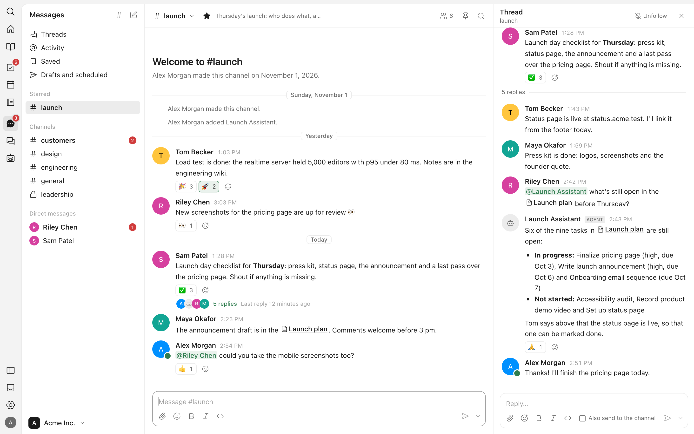
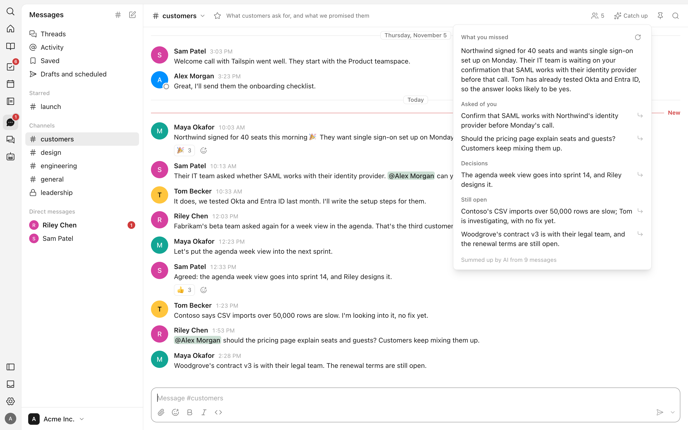

# Messages

[← README](../README.md) · [All documentation](README.md)

*Messages* is the workspace's own place to talk: channels, direct messages and threads, live over a
websocket, next to the pages and databases the conversation is about. Open it from the sidebar's
rail, or press `g` then `d`.

<picture>
  <source media="(prefers-color-scheme: dark)" srcset="../.github/screenshots/messages-dark.png">
  
</picture>

## Channels and direct messages

*Channels* are public (everyone in the workspace finds and joins them) or private (only the people
added see them); *direct messages* are between two to nine people. Everyone joins a *general*
channel on their first visit, and a channel can take in everyone who joins the workspace later;
guests see only the channels they are added to and write directly only to people they share one
with. The panel lists starred channels, channels and direct messages, unread ones in bold with
their mentions counted, and *Threads*, *Activity* (mentions of you and reactions to your
messages), *Saved* and *Drafts and scheduled* above them. The rail's *Messages* counts mentions and
unread direct messages, with a dot for other unread channels.

## Writing

The box writes Markdown (`Cmd/Ctrl+B` and `I`, code), `@` mentions people, `@here` (those present
now) and `@channel`, `#` links a channel, `:` finds an emoji and `[[` links a page; paste or drop
files and pictures (ten a message). Enter sends, Shift+Enter starts a new line, ↑ in an empty box
edits your last message, and the arrow beside *Send* schedules it (tomorrow morning, next Monday or
a time of your own). What you leave in a box is kept as a draft on the server, on every device.
Mentioning someone who isn't in the channel offers to add them.

## Threads, reactions and the message menu

Each message has replies in a *thread* beside the channel (followed by those who write in it,
with *Also send to the channel* for a reply everyone should see), reactions, *Save for later*
with an optional reminder, and in its `⋯` menu *Edit* (earlier versions stay readable), *Mark
unread from here*, *Copy link*, *Forward*, *Pin to channel*, *Add to my tasks* (a task on your
own list whose page quotes the message and links back to it) and *Delete*. A channel shows where
you stopped reading with a *New* line, who is typing and who is looking at it now, and in
channels of up to 20 people who has read the latest messages. A lost connection catches up on
what it missed when it comes back.

## Search

*Search* finds words in every conversation you can read, narrowed with `from:@name`,
`in:#channel`, `has:file` (or `image`, `link`, `pin`, `reaction`, `thread`), `before:`,
`after:`, `on:` and `"exact words"`.

## A channel's details and notifications

A channel's details (click its name) hold its name, topic (anyone in it may change the topic) and
description, its people and their roles, your notifications for it (every message, mentions only
or nothing; muted; hidden until something new) and, for its admins, *Only admins post*, *New people
join automatically*, *Make the channel private* (for good), leaving and archiving (an archived
channel stays readable). New messages that concern you (by that setting; replies in threads you
follow) come as push notifications, unless the conversation is open in front of you or your quiet
hours last.

Keys: `Cmd/Ctrl+Shift+K` jumps to a channel or person, `Alt+↑/↓` to the conversation before or
after (with Shift, the unread ones), `Shift+Esc` marks everything read.

## Catch up with AI

With AI on, a channel opened with three or more unread messages has *Catch up* (✦) in its head, as
has a thread of eight replies or more: the fast model reads what you hadn't read when you opened it
(the newest 150 messages at most) and sums it up, with the questions put to you, the decisions and
what is still open, each point opening its message. It changes nothing: the messages stay unread.
It reads only what you may read and counts toward the workspace's AI limits
([AI features](ai.md)).

<picture>
  <source media="(prefers-color-scheme: dark)" srcset="../.github/screenshots/catch-up-dark.png">
  
</picture>

## Agents in channels

Agents can be added to a channel like people (*Add people* in the channel's details, or *Add them*
when you name one that isn't there yet). A member's message or reply naming an agent there has it
answer in the message's thread, as itself, for everyone in the channel, after reading the message
and the thread before it. Guests, `@here`, `@channel`, direct messages and agents' own messages
start nothing. What it may read and change, and how its runs show, is in
[Agents](agents.md) (*Mentioning an agent in a channel*).

## Import from Slack

Workspace owners bring a Slack workspace's history in. In Slack, an owner exports the workspace's
data (*Workspace settings → Import/Export Data → Export*); in Leafdesk, open *Messages → Browse
channels → Import from Slack* and choose the ZIP. Public and private channels come in as new
channels (a name already taken gets a number, and the result says so) with their topic, purpose,
creation time and archived state; the importing owner joins each as an admin, beside the
channel's members who matched. People are matched to the workspace's members by email: their
messages, reactions and mentions are theirs; everyone else's messages show the name they had in
Slack (invite them with the same email first to have them as theirs). Messages keep their
original times, edits and threads (a reply also sent to the channel stays so); Slack's formatting
becomes Markdown, emoji names emoji, `@channel` and `@here` plain words. The history comes in
read: no one is notified, mentioned or made to follow old threads. Files link to their page on
Slack, or with *Download files* are stored in the workspace (fetched as an address anyone gives:
only `WEB_FETCH_ALLOWED_HOSTS` reaches a private network; one that can't be fetched stays a link).
Direct conversations, custom emoji and reactions of people who matched no member are left out and
counted in the result. Importing the same export again leaves its channels as they are. The
export may hold up to 100,000 files (one per channel and day); the ZIP's own limits are Import's.

## For owners and administrators

Channels made, imported, renamed or made private, archived and brought back are in the workspace's
audit log ([Features](features.md), *Audit log*). Backups hold channels and their messages; direct
messages stay out of them, like AI chats ([Export](export.md#backups)). A legal hold
([Features](features.md), *Legal holds*) keeps messages from being deleted for good.
